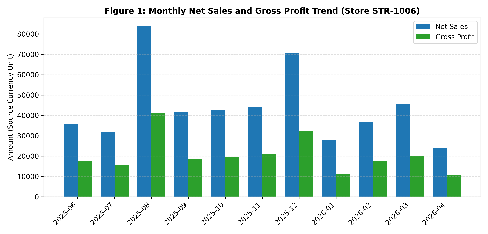
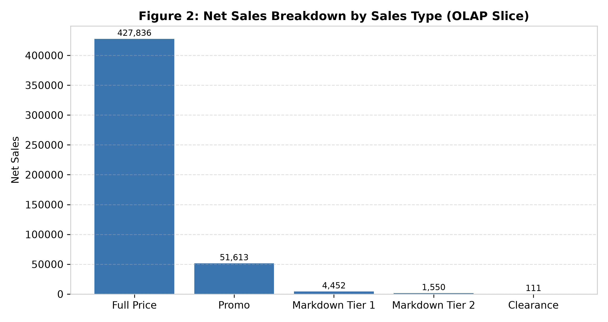
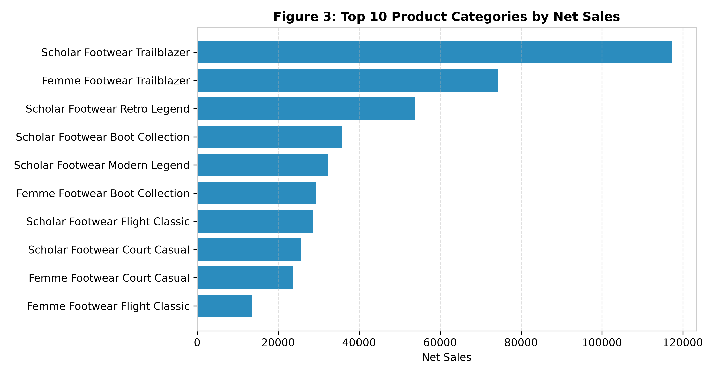
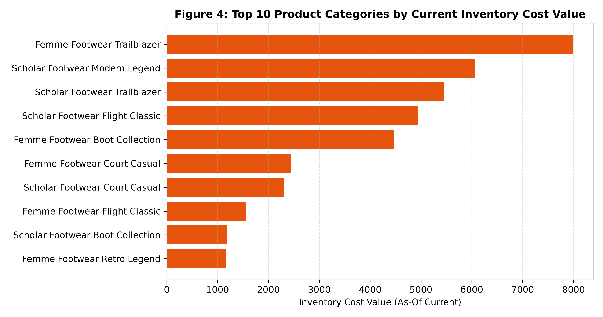
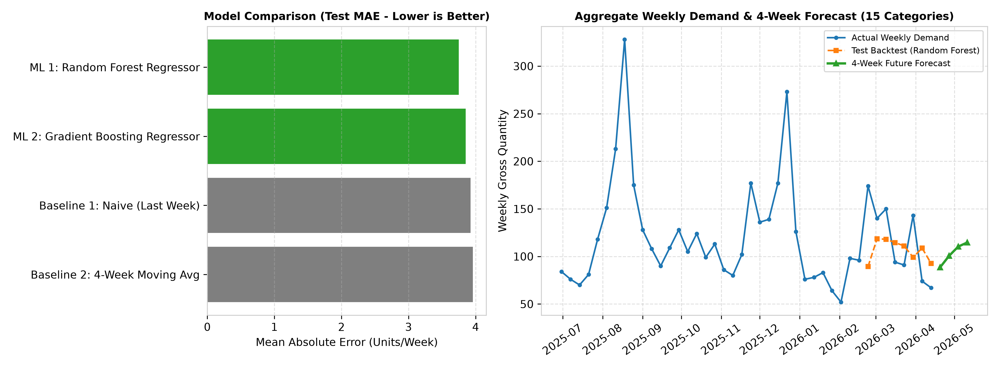

# BÁO CÁO TỔNG KẾT ĐỒ ÁN KHO DỮ LIỆU (DATA WAREHOUSE)
**Đề tài:** Xây dựng Kho dữ liệu Phân tích Doanh số, Quản lý Tồn kho và Dự báo Nhu cầu Hàng hóa trong Bán lẻ

---

## 1. Tổng quan & Phân tầng Dữ liệu (Data Architecture)

Dự án triển khai kiến trúc xử lý dữ liệu phân tầng (Medallion / Multi-tier Data Architecture) trên môi trường Windows local kết hợp **MySQL** và **Python**:

1. **Tầng Nguồn Bất Biến (`data/raw/`):** Lưu trữ nguyên bản gói dữ liệu `retail-transactions-and-stocks-data.zip` (SHA-256: `f65cb8ace7d2d7864986dde91ae658311cd334e5d6c742d3a9f9f8bfc9675480`), gồm 125.751 dòng Sales và 284.755 dòng Inventory trên 40 cửa hàng.
2. **Tầng Trung Gian (`data/staging/` & MySQL `stg_*`):** Lọc nhất quán dữ liệu của cửa hàng mục tiêu **`STR-1006`** (5.904 dòng Sales, 11.142 dòng Inventory, 323 ngày hoạt động từ `2025-06-01` đến `2026-04-24`, tỷ lệ khớp SKU giữa hai bảng đạt 95,0%).
3. **Tầng Kho Dữ Liệu Lõi (MySQL `retail_dw` — Constellation Schema):**
   * **5 Conformed Dimensions:** `dim_date` (329 bản ghi gồm ngày sentinel `9999-12-31`), `dim_product` (2.068 SKU), `dim_store` (1 cửa hàng), `dim_supplier` (30 nhà cung cấp), `dim_sales_type` (5 hình thức bán hàng).
   * **2 Fact Tables với Grain tách biệt:** `fact_sales` (Fully Additive — tổng hợp giao dịch theo tổ hợp chiều trong ngày) và `fact_inventory_interval` (Semi-Additive — khoảng hiệu lực `Start Date` đến `End Date`).
4. **Tầng Dữ Liệu Nghiệp Vụ (`data/processed/` & Semantic Views):** Bao gồm `vw_daily_product_sales`, `vw_current_inventory`, `vw_weekly_product_sales` và các bảng đầu ra của Machine Learning (`ml_model_metrics`, `ml_weekly_demand_forecast`).

---

## 2. Kết quả Đối soát Dữ liệu ETL (Data Reconciliation)

Quá trình nạp dữ liệu từ Staging sang Data Warehouse đảm bảo tính toàn vẹn và khớp chính xác 100% trên mọi chỉ số:

* **Bảng Sales:** `5.904` dòng | Tổng sản lượng thuần: `5,619` | Tổng doanh thu thuần: `485,561.44` | Tổng giá vốn thuần: `259,786.30`.
* **Bảng Inventory:** `11.142` dòng | Số bản ghi tồn kho hiện hành (`is_current = 1`): `576` dòng | Checksum `qty_on_hand`: `28.771`.

---

## 3. Kết quả Phân tích Kinh doanh & OLAP

### 3.1. Các chỉ số KPI Tổng hợp (`STR-1006`)
* **Doanh thu gộp (Gross Sales):** `514,665.31`
* **Giá trị hàng trả lại (Return Amount):** `29,103.87`
* **Doanh thu thuần (Net Sales):** `485,561.44`
* **Lợi nhuận gộp (Gross Profit):** `225,775.14` (**Biên lợi nhuận gộp: 43.87%**)
* **Sản lượng thuần (Net Qty Sold):** `5,619` sản phẩm (Bán gộp: `5,924`, Trả lại: `305`, Tỷ lệ trả: **5.15%**)
* **Tổng số lượt mua hàng:** `5,861` lượt

### 3.2. Phân tích Xu hướng & Cơ cấu Doanh thu
* **Tính mùa vụ theo tháng:** Doanh thu thuần đạt đỉnh mạnh vào **Tháng 8/2025** (`83.826,34`) và **Tháng 12/2025** (`70.858,46`).

* **Hiệu quả theo Hình thức bán hàng (`Sales Type`):** `Full Price` đóng góp **88,11%** tổng doanh thu thuần (`427.835,83`) và mang lại phần lớn lợi nhuận gộp (`210.952,87`). Nhóm `Promo` chiếm **10,63%** (`51.612,71`). Các mức giảm giá sâu như `Markdown Tier 2` và `Clearance` có lợi nhuận gộp âm do xả hàng dưới giá vốn.

* **Danh mục sản phẩm chủ lực:** Ngành hàng `Scholar Footwear` dẫn đầu toàn cửa hàng, nổi bật với các danh mục như `Scholar Footwear Trailblazer`, `Scholar Footwear Retro Legend` và `Scholar Footwear Modern Legend`.

### 3.3. Phân tích Tồn kho Hiện hành (`As-Of Current`)
Tại thời điểm chốt dữ liệu (`is_current = 1`):
* **Tổng số lượng tồn kho (`On-Hand Qty`):** `900` sản phẩm trên `576` SKU đang theo dõi.
* **Tổng giá trị tồn theo giá vốn:** `43,703.15` | **Theo giá bán lẻ:** `88,492.39`.

---

## 4. Kết quả Dự báo Nhu cầu bằng Machine Learning

* **Thiết kế thực nghiệm:** Tổng hợp nhu cầu bán gộp theo **Tuần** qua 46 tuần trọn vẹn (`2025-06-02` đến `2026-04-19`) cho **15 Danh mục sản phẩm** có lịch sử bán hàng liên tục ($\ge 100$ sản phẩm). Chia tập theo thời gian (**Temporal Split**): 34 tuần huấn luyện và **8 tuần cuối kiểm thử** (`2026-02-23` $
ightarrow$ `2026-04-19`), không sử dụng dữ liệu tương lai để tạo đặc trưng trễ.
* **Bảng đánh giá hiệu năng mô hình trên tập Test:**

| model_name                        |   MAE |   RMSE |   WAPE_pct |
|:----------------------------------|------:|-------:|-----------:|
| ML 1: Random Forest Regressor     | 3.75  |  5.029 |      48.24 |
| ML 2: Gradient Boosting Regressor | 3.853 |  4.931 |      49.55 |
| Baseline 1: Naive (Last Week)     | 3.925 |  5.262 |      50.48 |
| Baseline 2: 4-Week Moving Avg     | 3.96  |  5.151 |      50.94 |

* **Nhận xét:** Mô hình **Random Forest Regressor** đạt sai số thấp nhất (`MAE = 3,750`, `WAPE = 48,24%`), vượt qua cả hai mô hình cơ sở (`Naive Forecast` và `4-Week Moving Average`). Mô hình này được sử dụng để dự báo nhu cầu 4 tuần tiếp theo (`2026-04-20` $
ightarrow$ `2026-05-17`) và tích hợp vào Dashboard Streamlit để cảnh báo nguy cơ thiếu hàng hoặc tồn kho cao.

---

## 5. Giới hạn của Hệ thống & Hướng Phát triển

1. **Độ thưa dữ liệu cấp SKU:** Tốc độ bán của từng SKU đơn lẻ khá thấp (1–2 sản phẩm/tuần), do đó mô hình dự báo hoạt động hiệu quả nhất ở cấp độ `Product Category` theo tuần.
2. **Đơn vị tiền tệ & Dữ liệu khách hàng:** Dataset nguồn không định danh đơn vị tiền tệ cụ thể và không có `Customer ID`, giới hạn khả năng phân tích phân khúc khách hàng.
3. **Hướng mở rộng:** Tích hợp thêm dữ liệu lịch khuyến mãi dự kiến, thời gian giao hàng của nhà cung cấp (Lead Time) để nâng cấp bài toán từ dự báo nhu cầu sang tối ưu điểm đặt hàng lại (Reorder Point Optimization).
